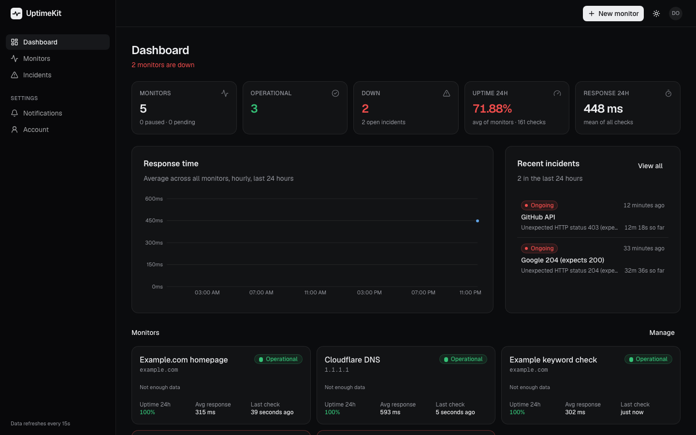
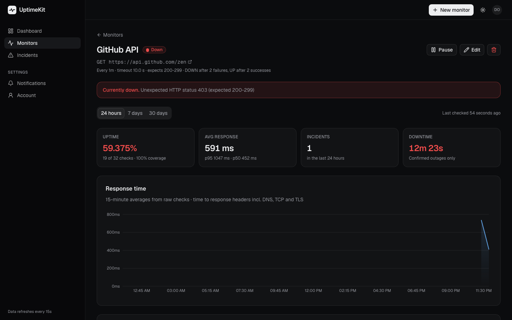
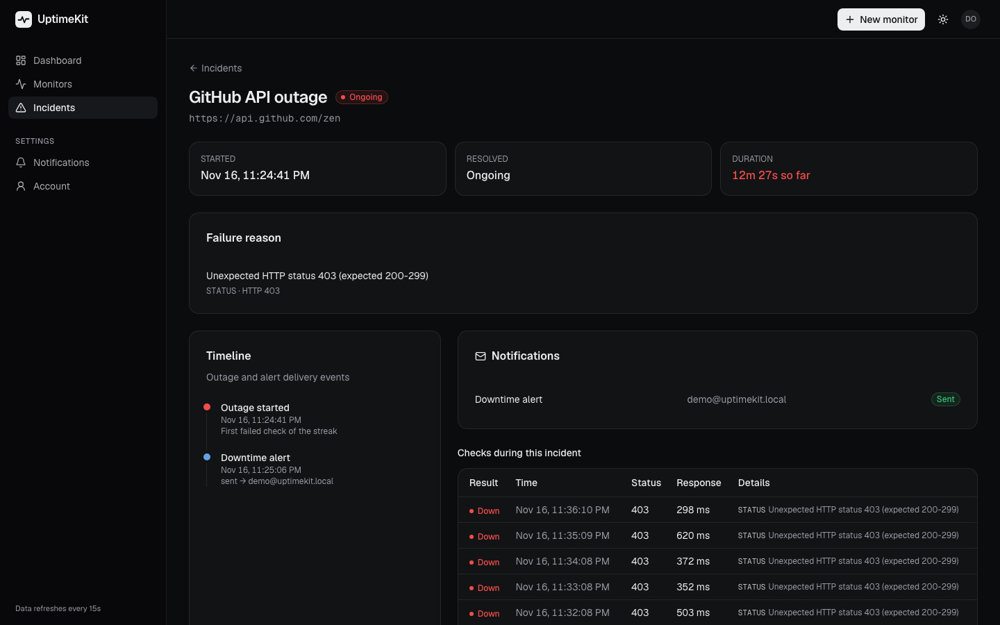
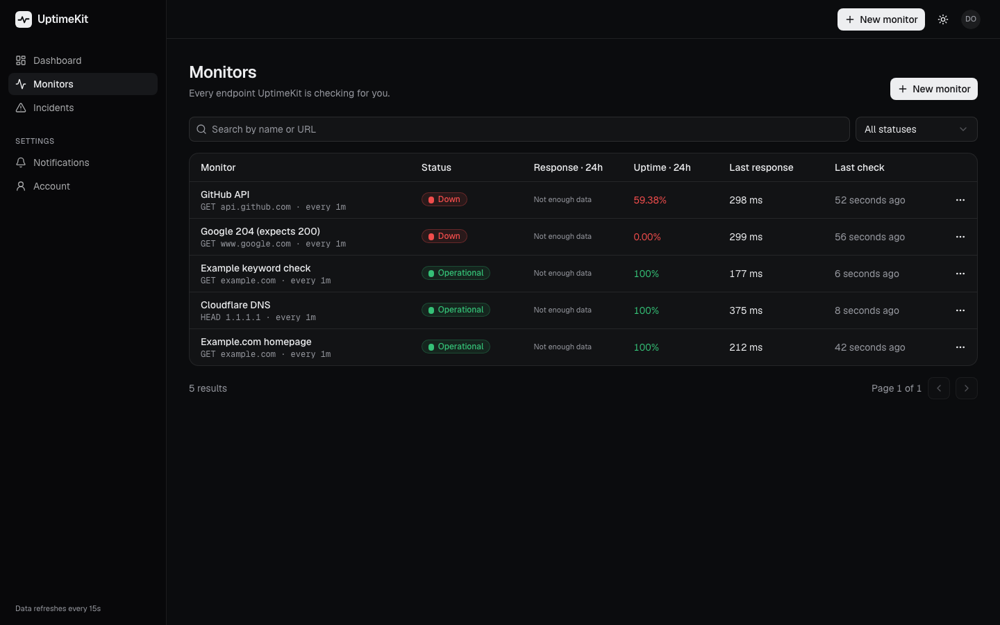
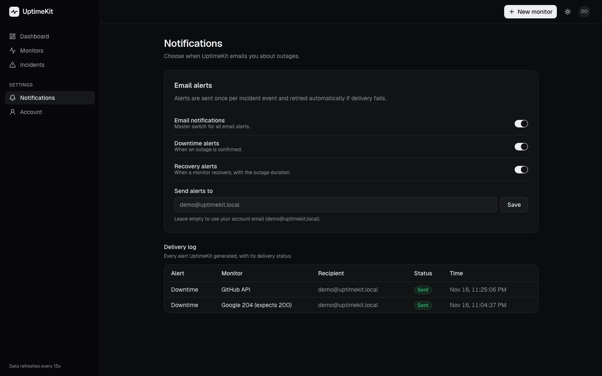
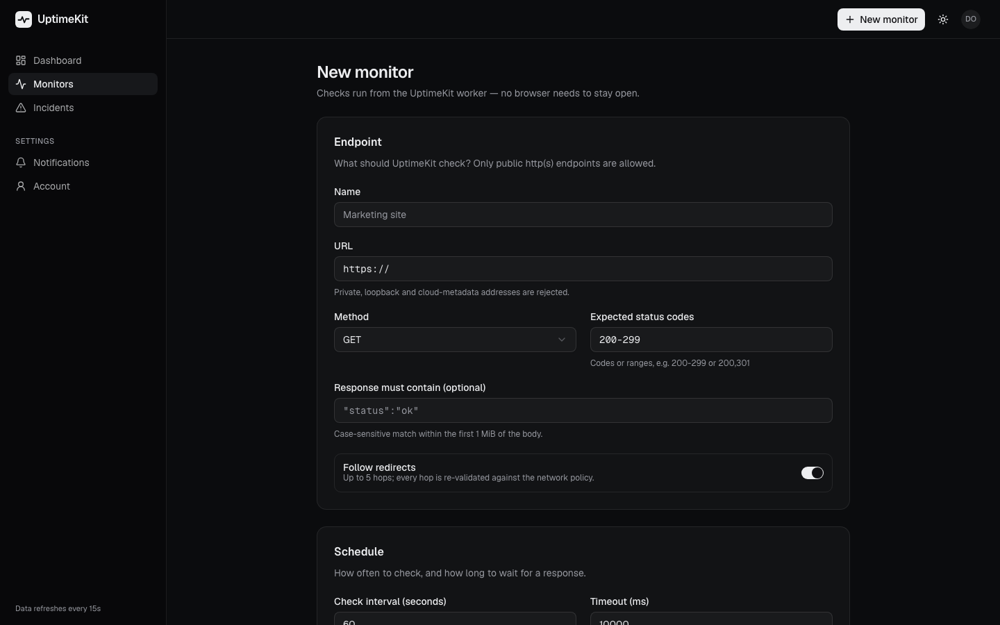
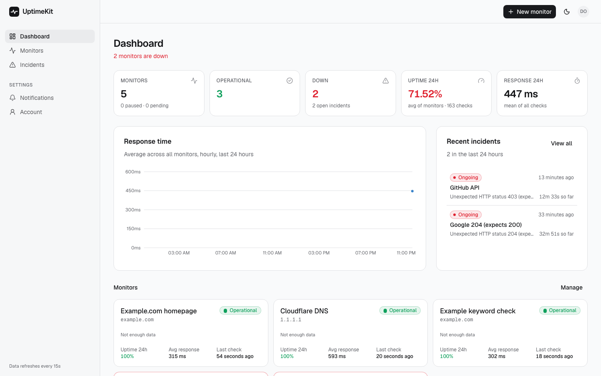
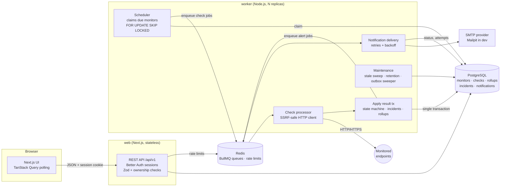

# UptimeKit

**Open-source website and API uptime monitoring with real-time incident detection, response
analytics, background workers and email alerts.**

UptimeKit checks your HTTP(S) endpoints from a background worker, waits for confirmation before
declaring an outage, opens exactly one incident per outage, emails you when it goes down and when it
recovers, and turns every check into uptime and latency history.

**Live:** [web-production-8c11c7f5.up.railway.app](https://web-production-8c11c7f5.up.railway.app) ·
**[Live demo (no sign-up)](https://web-production-8c11c7f5.up.railway.app/demo)**



> Screenshots come from a local instance monitoring real public endpoints, about 40 minutes after
> it started, so the charts show a short history. Nothing in them is seeded or simulated. The two
> incidents are real: one monitor is deliberately misconfigured (it expects `200` from Google's
> `/generate_204`), and `api.github.com` began returning `403` once its unauthenticated rate limit
> was hit.

## Features

- **Real HTTP(S) checks**: GET or HEAD, configurable interval and timeout, expected status codes and ranges, an optional body keyword, and redirect handling.
- **No false alarms**: a monitor only changes status after a configurable number of consecutive failures or successes, and faster retries run while a change is being confirmed.
- **Incident lifecycle**: an incident starts at the first failed check, ends at the first successful one, and records how long it lasted. The database guarantees only one open incident per monitor.
- **Email alerts**: downtime and recovery emails. Delivery goes through a transactional outbox with retries and backoff, each attempt is logged, and you can turn alerts off per user or per monitor.
- **Analytics**: uptime over 24 hours, 7 days and 30 days, with *coverage*. Missing data is never counted as uptime. Also latency average, p50 and p95, downtime, and a 30-day daily uptime history.
- **Dashboard**: status totals, a response-time chart, recent incidents and monitor cards with sparklines. Data refreshes every 15 seconds, with dark and light themes.
- **Security**: SSRF protection with connection pinning that defeats DNS rebinding, ownership checks on every query, rate limiting, CSRF origin checks and Zod validation everywhere.
- **Public read-only demo**: `/demo` lets anyone explore dashboards, a degraded and a down monitor, incidents and recovery history. It is rendered from clearly labelled, deterministic sample data and never touches the production database.
- **Built to scale out**: Postgres `SKIP LOCKED` scheduling and BullMQ workers, so you can run as many worker replicas as you need. The web app and the worker deploy independently.

| | |
| --- | --- |
|  |  |
|  |  |
|  |  |

## Architecture



The database is the source of truth for scheduling. Redis only carries work, so losing Redis
loses no schedule. The web app never talks to the queue: creating or pausing a monitor is a
database write, and monitoring does not depend on anyone having a browser open.

See [docs/MONITORING.md](docs/MONITORING.md) for the full engine design.

## Tech stack

| Layer | Technology |
| --- | --- |
| Web | Next.js 16 (App Router), React 19, TypeScript (strict), Tailwind CSS v4, shadcn/ui, Lucide, Recharts, TanStack Query |
| Auth | Better Auth (email/password, scrypt, database sessions) |
| API | Next.js route handlers, Zod 4 |
| Worker | Node.js 22, BullMQ 5, ioredis, pino, nodemailer |
| Data | PostgreSQL 17, Prisma 7 (`@prisma/adapter-pg`) |
| Testing | Vitest 4, React Testing Library, Playwright |
| Infra | Docker (multi-stage, non-root), Docker Compose, GitHub Actions |

### Repository layout

```
uptimekit/
├── apps/
│   ├── web/              Next.js UI + REST API
│   └── worker/           scheduler, checker, incidents, notifications
├── packages/
│   ├── database/         Prisma schema, migrations, client, test-DB helper
│   ├── shared/           Zod schemas, state machine, analytics, SSRF policy, HTTP checker
│   └── config/           shared tsconfig + ESLint config
├── tests/e2e/            Playwright suite (real stack)
├── docs/                 design, API, security, deployment docs and screenshots
├── docker-compose.yml
└── .github/workflows/ci.yml
```

`packages/shared` holds the logic that both apps need, such as validation and URL policy. It
also holds the parts that must be unit-testable in isolation: the state machine, analytics and
the checker. The worker and the web app stay thin.

## Local installation

**Requirements:** Node.js 22+, pnpm 10 (`corepack enable`), and Docker.

```bash
git clone https://github.com/rajithdev/uptimekit.git
cd uptimekit
pnpm install
pnpm db:generate              # generate the Prisma client
cp .env.example .env          # then set BETTER_AUTH_SECRET: openssl rand -base64 32
pnpm infra:up                 # Postgres :5442, Redis :6380, Mailpit :1026/:8026
pnpm db:deploy                # apply migrations
pnpm dev                      # web on http://localhost:3000 + worker
```

Open http://localhost:3000, create an account and add a monitor. Alert emails land in Mailpit at
http://localhost:8026.

Host ports are deliberately non-default (5442, 6380, 1026, 8026) so they don't clash with other
local projects. You can override them with `POSTGRES_HOST_PORT` and the other `*_HOST_PORT`
variables.

**Run everything in containers instead:**

```bash
docker compose --profile app up -d --build --wait   # web on http://localhost:3000
```

## Environment variables

See [`.env.example`](.env.example) for the complete annotated list, and
[docs/DEPLOYMENT.md](docs/DEPLOYMENT.md#environment-variables) for which service needs which
variable.

| Variable | Purpose |
| --- | --- |
| `DATABASE_URL` | PostgreSQL connection |
| `REDIS_URL` | Redis (BullMQ queues; shared rate limits) |
| `APP_URL` | Public URL of the web app (cookies, origin checks, email links) |
| `BETTER_AUTH_SECRET` | Session signing secret |
| `EMAIL_PROVIDER`, `EMAIL_FROM`, `SMTP_*` | Email delivery (Mailpit locally, any SMTP provider in production) |
| `MONITOR_MIN_INTERVAL_SECONDS`, `MAX_MONITORS_PER_USER` | Abuse limits |
| `WORKER_CONCURRENCY`, `SCHEDULER_TICK_MS`, `CHECK_RETENTION_DAYS` | Worker tuning |
| `CHECKER_ALLOW_CIDRS` | **Dev/test only**: allows checks to reach the listed ranges. Refused in production |

## Running tests

Tests run against real services. Start the infrastructure first with `pnpm infra:up`.

```bash
pnpm test                 # all unit + integration suites
pnpm test:unit            # pure logic + React components
pnpm test:integration     # API and worker against Postgres/Redis/Mailpit
pnpm build && pnpm test:e2e   # Playwright against a production build + real worker
pnpm lint && pnpm typecheck
```

| Suite | Count | What it covers |
| --- | --- | --- |
| `packages/shared` | 152 | SSRF IP/URL policy (loopback, private, metadata, IPv6, encodings), DNS rebinding, redirect revalidation, body cap, timeouts, the state machine, retry rules, uptime and latency math, Zod schemas |
| `apps/worker` | 34 | incident lifecycle, 25-way concurrent result application (exactly one incident), DB-enforced uniqueness, multi-scheduler claims, stale jobs, real HTTP checks via BullMQ, **real SMTP delivery to Mailpit**, retry and backoff, outbox sweeper, retention, stale sweep |
| `apps/web` | 56 | auth (hashing, cookies, rate limits), every endpoint's 401 response, CRUD, SSRF on create and update, mass assignment, CSRF, monitor cap, API rate limits, **cross-user isolation**, pagination and filters, stats math, component behaviour |
| `packages/database` | 2 | migration manifest matches `prisma/migrations`; no destructive SQL without an explicit marker |
| `tests/e2e` | 18 | register, login and logout, create a monitor, see real results, outage → incident → email → recovery → email, isolation, pause and resume, delete; public demo (no API calls, no mutation controls, mobile layout); axe-core WCAG 2.1 AA scans |

Local HTTP test servers play the working, failing and slow endpoints, so results are
deterministic. Mocks are used only to force SMTP failures in the retry test. Real delivery is
covered separately.

## How monitoring works (short version)

1. **Schedule:** the worker claims due monitors from Postgres and advances `next_check_at` in
   the same statement. It then enqueues BullMQ jobs with deterministic IDs.
2. **Check:** the request runs through the SSRF-safe client. It validates the URL, checks every
   resolved IP at connect time, caps the body, and re-validates every redirect hop.
3. **Evaluate:** in one transaction that locks the monitor row, the worker records the check,
   updates the hourly rollup, and runs the state machine. A status changes only after
   `failureThreshold` consecutive failures, or `recoveryThreshold` consecutive successes.
4. **Incidents:** if the monitor is `DOWN` with no open incident, one is opened. If it is `UP`
   and an incident is open, the incident is resolved. A partial unique index makes duplicate
   incidents impossible.
5. **Alerts:** notification rows are written in the same transaction (an outbox), then delivered
   by a queue with retries. The unique key `(incident, type, channel)` prevents duplicate
   alerts.

**Uptime** is successful checks divided by recorded checks. Paused time and missing data are
never counted as uptime. Windows without checks show *No data*, and a *coverage* figure shows
how much data the number is based on. Full definitions are in [docs/MONITORING.md](docs/MONITORING.md).

## Design decisions

| Decision | Why |
| --- | --- |
| DB-driven scheduling instead of BullMQ repeatable jobs | A single source of truth, safe with many workers (`SKIP LOCKED`), nothing lost if Redis is flushed, and natural backpressure |
| Incidents decided by (status, open incident?) rather than by transitions | Idempotent under retries and replays; backed by a partial unique index |
| Transactional outbox for alerts | An incident and its alert commit atomically; delivery is retried independently |
| Node `http`/`https` with a custom `lookup` rather than `fetch` | It is the only way to validate the exact IP the socket connects to, which defeats DNS rebinding |
| Hourly rollups maintained per check | 7- and 30-day stats read at most 720 rows per monitor; raw checks can be pruned |
| Latency = time to response headers | Comparable across endpoints regardless of body size; includes DNS, TCP and TLS |
| Better Auth over NextAuth v5 | Maintained and stable, with built-in email/password, rate limits and session management (NextAuth v5 is still in beta) |
| pnpm workspaces without Turborepo | Fewer moving parts at this size |
| BullMQ 5 over the newly released 6.x | A mature, well-understood API |

## Security considerations

SSRF is the main threat for a service that requests user-supplied URLs. UptimeKit defends
against it in layers:

- URL scheme and hostname rules
- IP-range classification
- **connection pinning**: every resolved address is validated inside the socket's DNS lookup
- manual redirects that are re-validated on every hop
- strict timeouts and size limits

On top of that come user-scoped queries that return `404` for resources the caller doesn't own,
strict Zod schemas, CSRF origin checks, Redis-backed rate limits, httpOnly SameSite cookies,
redacted logs and non-root containers. Details and the test inventory are in
[docs/SECURITY.md](docs/SECURITY.md).

## API

REST endpoints live under `/api/v1`: monitors (CRUD, pause/resume, checks, stats), incidents,
notification settings and the delivery log, and the dashboard summary. Lists support
pagination, sorting and filtering, and errors use one consistent envelope. See
[docs/API.md](docs/API.md).

## Deployment

The web app, the worker and the migration job are independent images. You need PostgreSQL,
Redis and an SMTP provider. [docs/DEPLOYMENT.md](docs/DEPLOYMENT.md) has the environment matrix,
platform steps and a deployment checklist.

> No hosted deployment exists yet; it requires credentials and authorization. The local Docker
> Compose stack has been verified end to end.

## Known limitations

- Checks run from one location; there is no multi-region consensus yet.
- Email delivery is at-least-once: a crash at exactly the wrong moment can send a duplicate.
- Past pause periods are not stored, so coverage for previously paused monitors is under-reported.
- There is no password reset or email verification flow yet.
- The hosted instance sends alerts through Resend's test sender until a domain is verified, so only the Resend account owner receives them.
- Monitored endpoints can't take custom request headers or auth (intentional for v1, to avoid storing secrets).
- If Redis is down, the web app's rate limits fall back to per-process memory.

## Roadmap

- Public status pages
- Slack, Discord and webhook notification channels
- Encrypted custom headers for authenticated endpoints
- Multi-region checks with quorum
- TLS certificate expiry and keyword-absence monitors
- Maintenance windows
- An OpenAPI specification

## License

[MIT](LICENSE)
